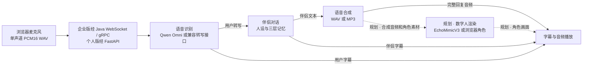

# 数字人 Beta · Qwen 与语音链路

GA 的数字人拆为语音和画面两部分。语音已经接入企业版和个人版的对话流程。画面渲染处于原型阶段，工作区保留 EchoMimicV3 实验目录。

## 功能状态

| 能力 | 当前实现 |
| --- | --- |
| 录音与播放 | 浏览器录制单声道 PCM16 WAV，发送完一段录音后播放伴侣回复。两个版本均已用模拟语音通过浏览器联调 |
| 语音识别 | Python 可用 Qwen Omni 的音频输入转写，也支持兼容 `/audio/transcriptions` 的识别服务 |
| 伴侣回复 | 转写结果进入文字对话用的伴侣人设、三层记忆和 BM25 召回 |
| 语音合成 | Python 可用兼容 `/audio/speech` 的 TTS 服务生成 WAV，也可用 Edge TTS 生成 MP3 |
| 数字人画面 | `AImodel/echomimic_v3` 为独立实验。GA 页面当前展示伴侣状态、文本和音频播放器 |

## 信号流程

语音回合在合成出可播放音频后保存文字。识别或合成失败时，界面显示错误，后续对话仍可继续。录音按钮当前以约 20 秒为上限。服务端接口允许采样率 8–48 kHz、最长 60 秒和最多 8 MiB 的单声道 PCM16 WAV。

- **企业版**。浏览器向 `/audio` WebSocket 发送二进制音频帧，以一个空帧结束一次录音。Java 通过双向 gRPC 转发。回复含字幕、音频 MIME 类型、完整音频帧和结束事件。
- **个人版**。浏览器向 `POST /v1/voice` 发送 `Content-Type: audio/wav` 和 Bearer Token。FastAPI 响应包含 `user_text`、`text`、`audio_base64`、`audio_content_type`。

## Qwen 与语音服务配置

`qwen2.5:7b` 用于本地文字对话。语音识别用支持音频输入的 Qwen Omni 模型，或者单独的 ASR 模型。Qwen Omni 适配器发送 `input_audio` 中的 WAV 数据并请求文字输出。选择模型时确认托管服务实现了对应的流式 Chat Completions 协议。[Qwen Omni 接口文档](https://www.alibabacloud.com/help/zh/model-studio/qwen-omni)

下表列出个人版的变量。企业版在相同变量名的 `GA_` 后加 `ENTERPRISE_`，例如 `GA_ENTERPRISE_ASR_PROVIDER`、`GA_ENTERPRISE_ASR_BASE_URL` 和 `GA_ENTERPRISE_TTS_VOICE`，由企业部署方提供识别与合成 API。

| 配置 | 含义 |
| --- | --- |
| `GA_ASR_PROVIDER=qwen-omni` | 用 Qwen Omni 的 `/chat/completions` 识别音频 |
| `GA_ASR_PROVIDER=openai` | 用兼容 `/audio/transcriptions` 的识别端点 |
| `GA_ASR_BASE_URL`、`GA_ASR_MODEL`、`GA_ASR_API_KEY` | 选择识别服务，填写它实际要求的 API 基址、模型名和密钥 |
| `GA_TTS_PROVIDER=openai` | 用兼容 `/audio/speech` 的端点合成 WAV，可连接部署了兼容语音模型的 vLLM-Omni |
| `GA_TTS_PROVIDER=edge` | 调用 Edge TTS 在线合成 MP3 |
| `GA_TTS_BASE_URL`、`GA_TTS_MODEL`、`GA_TTS_API_KEY`、`GA_TTS_VOICE` | 选择合成服务和语音。伴侣配置中的声音标识优先 |
| `GA_ASR_PROVIDER=mock`、`GA_TTS_PROVIDER=mock` | 返回固定转写和可播放的测试音，用来联调浏览器和传输 |
| `GA_ASR_PROVIDER=disabled` 或 `GA_TTS_PROVIDER=disabled` | 关闭语音功能，保留文字对话 |

ASR 和 TTS 需分别选择端点。本地化部署时，两者都指向自托管服务。若使用托管 ASR，录音会发送到对应服务。使用 Edge TTS 时，待合成的伴侣文本会发送给在线合成服务。GA 的 Docker 镜像和 Python 安装包提供适配器，模型权重由各推理服务管理。[vLLM-Omni Speech API](https://docs.vllm.ai/projects/vllm-omni/en/stable/serving/speech_api/)

## 数字人 Beta 的后续接入

让语音链路先产出文字和完整合成音频，渲染端再消费这两份结果。采用 EchoMimicV3 时，下一步是用固定角色素材和合成音频验证一轮短视频生成，再接入异步渲染任务。角色画面较慢或不可用时，用户仍可阅读字幕和播放声音。浏览器角色动画可以另行验证用播放中的音频振幅驱动嘴部开合。[EchoMimicV3 上游仓库](https://github.com/antgroup/echomimic_v3)

验收顺序如下。

1. 用同一段普通话 WAV 分别检查 Qwen 转写、伴侣回复、合成音频及字幕质量。
2. 测量录音停止到语音可播放的耗时，并分别记录识别、对话和合成耗时。
3. 用固定角色素材和同一段合成音频测试口型与画面，再测渲染耗时、显存和错误恢复。

当前已验证模拟模型下的录音、字幕、音频播放、对话历史恢复，以及 Qwen Omni / TTS 请求结构。真实语音模型品质和数字人渲染仍需按以上流程验收。

## 代码入口

- [Python 识别、合成与对话编排](../GAagent/virtual_lover_agent/app/voice.py)
- [个人 FastAPI 语音接口](../GAagent/virtual_lover_agent/app/fastapi_server.py)
- [企业 gRPC 音频契约](../VR_Gfriend/src/main/proto/agent_proto.proto)
- [EchoMimicV3 本地实验说明](../AImodel/echomimic_v3/README_zh.md)
- [GA 双版本架构](.md)
